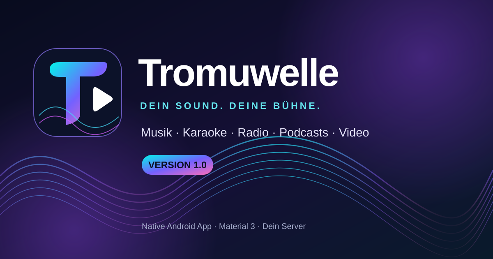

# Tromuwelle Android

Nativ implementierter Android-Client für das **private Hauptrepository Tromuwelle**. Kotlin, Jetpack Compose, Material 3, Media3/ExoPlayer, MediaLibraryService und ein gemeinsamer authentifizierter OkHttp-Transport – **keine WebView**.

**Funktionsabgleich:** [docs/feature-parity.md](docs/feature-parity.md) (laufender API-Abgleich mit dem aktuellen privaten Tromuwelle-Server).

## v1.0.0 – Aurora-Design und synchronisiertes Karaoke



- **Neue Identität:** Komplett neue neonglänzende T-/Play-/Wellen-Bildmarke als adaptives Android-Launcher-Icon für Smartphone und Automotive, inklusive monochromer System-Icon-Variante.
- **Aurora-Oberfläche:** Überarbeitete globale Material-3-Farben und Typografie, App-Kopf, Tablet-Navigation, Mini-Player, Medienkarten, Bibliothekslisten, Startseiten-Hero und Anmeldeseite. Bestehende Paletten, Hell-/Dunkelmodus, Systemanpassung und alle Medienfunktionen bleiben erhalten.
- **Karaoke ohne auseinanderlaufende Tonspuren:** Instrumental und Gesang (sowie 6-Stem-Versionen) warten auf einen gemeinsamen READY-Zustand. Bei Rebuffering pausieren alle Spuren zusammen; ein Master-Zeitgeber korrigiert kleinere Abweichungen behutsam per Geschwindigkeitsregelung und größere sofort per Seek. Tempo/Tonhöhe werden dabei auf alle Spuren übertragen.
- **Timing-Feinabgleich:** In der Karaoke-Regie kann die Gesangsspur pro Song in 25-ms-Schritten um ±400 ms justiert werden. Der Offset wird lokal pro Server und Karaoke-Version gespeichert.
- **Qualitätskontrolle:** Android Mobile und Automotive laufen durch Gradle Unit-Tests, Android Lint und die APK-Builds in GitHub Actions. Timing-Korrekturen sind zusätzlich durch JVM-Tests abgedeckt.

**Wichtige Grenzen:** Mehrere unabhängig dekodierte Media3-Player sind keine samplegenau gekoppelte DAW-Audio-Engine. Die Barriere und Driftkorrektur verhindern typisches hörbares Auseinanderlaufen, garantieren aber keine samplegenaue Synchronität auf sämtlicher Android-Hardware. Ein physischer Smartphone-Test mit echter Tromuwelle-Serverinstallation und wechselnden Audioausgängen sowie Automotive-/TalkBack-Tests sind weiterhin erforderlich. Der automatische GitHub-Build liefert derzeit **debugsignierte** APKs mit temporärem Schlüssel und ist kein produktiv signierter Play-Store-Build. Bestehende Installationen mit anderer Signatur benötigen ggf. eine Neuinstallation.

## v0.9.0-beta.1 – natives Karaoke-Studio

Die Android-App bietet jetzt das Karaoke-Modul ohne WebView direkt über **Startseite → Karaoke-Studio**, **Musik → Karaoke** und **Profil → Karaoke**.

- **Singbereit:** Vorbereitete 2- und 6-Stem-Songs mit Cover, Suche, Sortierung, Profilwahl, Seitensteuerung und Direktstart.
- **Vorbereiten:** Eigene Karaoke-Versionen serverseitig erstellen, laufende CPU-Aufträge und Worker-Status einsehen, Aufträge abbrechen.
- **Bühne:** Synchronisierte Zeilen- und Wort-Lyrics, Ausklang, längere Lesepausen, Countdown, animierte Übergänge, Wiedergabe, Seek, Lautstärke, Tempo und Tonhöhe. Vollbild ist **optional**, ein Exit-Button bleibt sichtbar. Regie/Fader sind in einem separaten aufklappbaren Mischpult-Bottom-Sheet.
- **Audiomodi:** 2-Stem-Instrumental über den bestehenden Media3-Hintergrunddienst mit MediaSession und Sperrbildschirmsteuerung, optionaler Gesangsfader während geöffneter Bühne; 6-Stem-Studiomix über sechs synchronisierte native Media3-Decoder mit unabhängigen Fadern. **Für sechs Stems muss die Bühne geöffnet bleiben**; Hintergrundbetrieb über den OS-Dienst ist für die 2-Stem-Version ausgelegt.
- **Solo-Setliste:** Titel sammeln und sortieren, direkt starten, automatisch zum nächsten Eintrag.
- **Party-Regie:** Party anlegen und auswählen, Singer, Songwünsche, Reihenfolge, manuelle und automatische Steuerung, Einladungs-QR ohne Drittanbieter, Link kopieren/teilen, Party beenden.
- **Sicherheit:** Bestehendes HTTPS-/Cookie-/Zertifikatsmodell, Berechtigungen bleiben vollständig serverseitig, Playback-Leases werden regelmäßig erneuert und beim Schließen freigegeben.

**Wichtig:** Diese Beta benötigt ein aktiviertes Karaoke-Modul auf dem Tromuwelle-Server. CI-Tests und Android-/AAOS-Builds sind nicht mit einer Abnahme auf echten Geräten und gegen einen produktiven Backend-Server gleichzusetzen. Siehe [Funktionsabgleich](docs/feature-parity.md).

## v0.8.0-beta.1 – neue Tromuwelle-Module und Podcasting-2.0-Kapitel

Die Android-App wurde mit dem aktuellen **Tromuwelle-Backend und Webfrontend** abgeglichen. Die Navigation bleibt eine kompakte 5-Tab-Navigation; neue Bereiche sind auf der Startseite unter „Mehr entdecken“ sowie im jeweiligen Medienbereich und im Profil zugänglich.

- **Öffentlich-rechtliche Mediatheken:** Eigene native Material-3-Bibliothek für ARD, ZDF, ARTE und weitere Sender über `/api/mediatheken`. Suche mit Tipp-Pause, Senderauswahl, Sortierung, Mindestdauer, Fehler- und Ladezustände, Serverkatalog-Status und seitenweise Ergebnisse. Verfügbare HTTPS-Videos werden direkt mit Media3 und dem bestehenden Videoplayer abgespielt. Unbekannte/unsichere Media-URLs werden nicht ungeprüft abgespielt; Anbieter-Websites öffnen sich nur über sichere, validierte Weblinks. Die Sender bestimmen Verfügbarkeit und Geoblocking.
- **US-Flug- & Einsatzfunk:** Separater nativer Bereich für rechtlich freigegebene ATC-/Feuerwehr-Audiostreams, Flughäfen, ICAO-/US-Staat-Suche, Funkfrequenzen, Bahndaten und aktuellen bzw. serverseitig gecachten OpenSky-Luftverkehr. Die Daten kommen über `/api/airwaves`, die Streams nutzen **denselben Media3-/Audiofokus-/Bluetooth-Player wie Radio**. ATC-Verzeichnis ist klar als Such-/Linkkatalog getrennt von tatsächlich abspielbaren Quellen; kein Scraping/Umgehen fremder Streamrechte. Wenn das Modul im Server abgeschaltet ist, respektiert die App dies.
- **Native Flughafenkarten:** MapLibre Native Android mit OpenFreeMap/OpenStreetMap-Vektorstil und Markern für höchstens 80 serverseitig gefilterte OpenSky-Positionen. Keine Anmeldung/Schlüssel, kein zusätzlicher Standortzugriff und keine Hintergrundabfrage auf dem Smartphone. OSM-Attribution wird angezeigt, OpenStreetMap im Browser bleibt als Alternative verfügbar.
- **Podcast-Kapitel:** Eigene Kapitelanzeige direkt im Podcast-Audioplayer über `/api/podcasts/episodes/{id}/chapters`, mit Auflistung, aktiver Kapitelerkennung und gezieltem Springen zu Kapiteln, ohne Transkripte oder den bestehenden Podcast-Modus zu verdrängen. Kapitel werden von Backend/Feed autorisiert und verarbeitet.
- **UI und Performance:** Material-3-Übersichtskarten in „Mehr entdecken“, kompakte Eingabefilter, adaptive Mediatheken-Kacheln, Seitensteuerung und abbrechbare, verzögerte Netzwerksuchen. Bestehende Farben und Benutzerpräferenzen bleiben erhalten.
- **Sicherheit und Checks:** Keine Übertragung lokaler Account-Cookies an ATC-Verzeichnisse als Audioquellen, unveränderte TLS-Vertrauensprüfung, keine unautorisierten Cast-Links für externe Mediathek-URLs. JVM-Regressionen für Kapitel-Sortierung und -Zeiten, HTTPS-Medienlinks sowie Funkstream-Namespace. GitHub CI baut Mobile und Automotive und führt Lint/Unit-Tests aus.

**Noch nicht vollständig gleichauf:** Das duale DJ-Studio und komplexe Quellen-/Operatorverwaltung bleiben web-orientiert; die native Flugkarte enthält keine Luftfahrt-Spezialkartenlayer und keine administrativen Quellenimporte. Hardware-, Bildschirmleser-, Netzwerk- und Live-Streaming-Tests mit realem Tromuwelle-Server stehen aus. Es werden Debug-signierte Betas bereitgestellt.

## v0.7.0-beta.1 – Chromecast-Stabilität, Material-3-Design und neue Anmeldung

**Google Cast:** Die Geräteauswahl nutzt wieder den Cast-Gerätepicker statt des Android-13-Systemausgabewählers, für den im bisherigen Setup die vollständige MediaTransferReceiver-Anbindung fehlte. SessionManagerListener und RemoteMediaClient.Callback reagieren ereignisgesteuert auf Verbinden, Trennen, Pufferung, Medienfehler und Wiederherstellung. Übertragungen bleiben bis zum bestätigten **Wiedergabestart** auf dem Receiver auch lokal hörbar. Gescheiterte oder ausbleibende Cast-Starts stoppen die lokale Wiedergabe nicht. Status, Zeitposition, Pause/Play, Stop und Wechsel zurück zum lokalen Gerät sind im Cast-Sheet verfügbar. Der Sender überträgt weiterhin **keine Cookies oder Passwörter**; die auf ein Medium beschränkten Cast-Tickets werden zusätzlich validiert. Der optionale HTTP-Bridge-Link darf nur an explizit angegebene private IPv4-LAN-Adressen auf Port 8098 gehen; öffentliches HTTPS bleibt Standard. Android Automotive bleibt von der Cast-Senderfunktion ausgeschlossen.

**Farben und Darstellung:** Zentrale Material-3-Implementierung statt fester Dark-only-Farben. Unter „Farben & Darstellung“ (Profil) und „Design“ (Login) sind Mint, Ozean, Violett, Sonnenuntergang und ab Android 12 dynamische Material-You-Farben wählbar. Helligkeit: System, Hell und Dunkel. Die Einstellungen bleiben ohne Benutzer-/Passwortbezug geräteweit gespeichert. Navigationsakzente, Vorschaubilder, Player und Listen verwenden die echten Theme-Farbrollen.

**Login / Connect:** Komplett neuer, responsiver Anmeldebildschirm mit prägnanter Überschrift, lesbaren Texten, kontrastreichen Formularflächen, Passwort-Sichtbarkeitsschalter, klarer Benutzerkonto-/Altmodus-Erklärung und Verbindungstest. Erstkonfiguration und explizite Prüfung selbstsignierter Zertifikate bleiben erhalten.

**Media3-Player:** Zustand „Stream wird gepuffert“, reaktives Lautstärke-Feedback, kompaktere Spurenauswahl und scrollbareres Dialogfenster für viele Audio- und Untertitelspuren. Der Startbildschirm-Hero bleibt im Hellmodus lesbar.

**Verifikation:** CI: Mobile und Automotive Unit-Tests, Lint, Debug-APK. Zusätzlich Tests für Cast-Ticket-URL-Sicherheit und gespeicherte Theme-Werte. Noch offen: Chromecast-/Google-TV-Gerätetest, Server-Proxy-Konfiguration, Netzwerkwechsel, dauerhaft signierte Releases, UI-Screenshot-/TalkBack-Test. Der Cast-Receiver muss den tatsächlichen Stream weiterhin selbst erreichen und dessen Container/Codec unterstützen.

## v0.6.3-beta.1 – Playback-Robustheit, gezielter Reconnect und effiziente Fortschritte

**Radio-Stabilität:** Die Wiederverbindung versucht bei echten Netzwerkfehlern und vorübergehenden HTTP-Serverfehlern höchstens dreimal mit kontrollierter Pause. Permanente Probleme wie HTTP 401/403/404 oder Decoderfehler lösen keine Endlosschleife aus. Ein beim Senderwechsel, Abmelden oder Player-Schließen bereits geplanter Neustart darf die aktuelle Wiedergabe nicht übernehmen. Im Audio-Player werden Fehler und ein manueller erneuter Versuch für Radio angezeigt.

**Sichere Medienwechsel:** Videometadaten und Untertitel werden weiterhin asynchron geladen, können aber nach einem Wechsel zu Musik, Podcast, anderem Film oder anderem Account nicht mehr einen neuen Titel überschreiben. Treffer aus der globalen Musiksuche werden auch dann zuverlässig abgespielt, wenn das eigentliche Musikverzeichnis noch nicht geladen wurde; es wird eine gültige Einzel-Titel-Queue verwendet.

**NAS-/Mobil-Performance:** Die Medienbibliothek bricht veraltete Such- und Filterladevorgänge ab und übergibt pro Request eingefrorene Filterwerte. Hörpositionen werden nur bei sinnvollen Änderungen gespeichert. Podcast-Fortschritt wird alle zwölf Sekunden geprüft und nur bei verändertem Stand oder Abschluss an den Server gemeldet, statt alle fünf Sekunden identische Daten zu schicken. Der Mini-Player reduziert Aktualisierungen im Ruhezustand.

**Mobile-UX:** Eine lesbare Radio-Fehleranzeige direkt im Player, kompakteres Cover auf kurzen Displays und mehr Platz für Songtitel in schmalen Mini-Playern.

**Tests/Grenzen:** Regressionstests für Retry-Beschränkungen, HTTP-Fehler, generierte Medienwechsel und Positionsschwellen. Android-CI kompiliert und lintet beide Flavors und erzeugt Debug-APKs. Echte Langzeittests mit instabilem WLAN/LTE, privaten Zertifikaten, Chromecast und Automotive stehen weiter aus.

## v0.6.2-beta.1 – externe Musikserver und Player verbessert

**Externe Subsonic-Bibliotheken:** Bei schnellen Wechseln zwischen Servern, Alben, Playlists und Suchanfragen werden vorherige Ladevorgänge abgebrochen und verspätete Antworten verworfen. Die Liste löscht beim Wechsel ihre veralteten Treffer, bietet automatische Suche mit kurzer Tipp-Pause, eine klare Aktualisieren-Schaltfläche und eine verständliche Kennzeichnung der Zufallstitelauswahl. Cover und Zeilen sind kompakter, einzeilig und besser bedienbar.

**Korrektes Paging:** Nur tatsächlich offset-paginierte Albenlisten und Suchergebnisse bieten „Weitere laden“. Einzeltitel aus Alben, Künstlerverzeichnisse, Playlists und zufällige Titel werden nicht mehr endlos „nachgeladen“. Der Paging-Offset folgt der Rohantwort des Servers, nicht nur der gefilterten Teilmenge, und wiederholte Treffer zwischen Seiten werden dedupliziert.

**Weniger TLS-Overhead:** Die separaten OpenSubsonic-Clientinstanzen nutzen einen gemeinsamen HTTPS-/TLS-OkHttp-Verbindungspool ohne geteilte Cookies oder Nutzercredentials. Coil-Requests für externe Cover werden zwischen Recompositions wiederverwendet; bei Änderung eines Server-Accounts wird seine signierte Bild-URL erneuert.

**Native Wiedergabe:** Klar beschriftete und zugängliche Play/Pause-, Vor-/Zurück-, Sprung-, Vollbild- und Bild-in-Bild-Bedienelemente, weniger periodische UI-Updates bei pausiertem Player und stabilere Fortschrittsanzeige während des Ziehens am Seek-Regler. Unit-Tests decken die Paging-Regeln und Zeitformatierung ab.

**Grenzen:** APKs sind vorerst Debug-signiert. Ein echter TLS-/OpenSubsonic-/Bluetooth-/Tablet-/Automotive-Dauertest und messbare FPS-/Akkulaufzeitvergleiche stehen weiterhin aus.

## v0.6.1-beta.1 – flüssigere Bibliotheken und gezielte Suche

- **Schnellere Suche auf schwachen oder entfernten Servern:** Die Kategorie-Filter begrenzen die tatsächlich ausgeführten Serverabfragen; beispielsweise lädt „Musik“ nicht gleichzeitig Radio, Live-TV, Filme und Podcasts. Abgebrochene Suchläufe werden korrekt behandelt, alte Ergebnisse bleiben beim Wechsel des Suchbegriffs oder Filters nicht kurz stehen. Globale Suche enthält weiterhin niemals die private 18+-Bibliothek.
- **Flüssigeres Scrollen:** Filme, Radio, TV und Album-Cover verwenden ein echtes adaptives `LazyVerticalGrid` mit stabilen IDs statt zeilenweiser `chunked`-Listen. Nachladen hängt Inhalte an, ohne vorhandene Karten unnötig umzubauen. Auf schmalen Telefonen bleibt die Ansicht zweispaltig; Tablets passen die Anzahl der Spalten an.
- **Ruhigere Cover-Ansichten:** Coil-Bildanfragen werden über Compose-Recompositions hinweg wiederverwendet. Statische Platzhalter ersetzen die vielen gleichzeitig animierten Ladeindikatoren; das entlastet UI-Thread und GPU. Poster-Fallbacks, begrenzte Thumbnail-Retries sowie sitzungsgetrennte Bild-Caches bleiben erhalten.
- **Qualität:** Ein zusätzlicher Regressionstest prüft, welche API-Bereiche der jeweilige Suchfilter durchsucht. Automatisierte APK-/Lint-/Unit-Test-Prüfung für Mobile und Automotive weiterhin über GitHub Actions. Echte Geräte-, Server- und Cast-Langzeittests stehen noch aus.

## v0.6.0-beta.1 – Smart Discovery und immersiver Streaming-Client

**Adaptive Bedienung:** Smartphone- und kompakte Querformatfenster behalten die Daumennavigation am unteren Rand. Große Tablets/Fenster wechseln automatisch auf die Material-3-Seitenleiste, sodass Medienposter mehr vertikale Fläche erhalten. Standardmäßig ist das Design dark-first, auf Cover, Filme und Musik ausgerichtet.

**Medien entdecken:** Die globale Suche ermittelt nach einer kurzen Tipp-Pause echte, serverseitig autorisierte Treffer aus Musik, regulären Filmen, Radio, TV und *Podcastfolgen*. Abschnittsfilter, lokale Relevanzsortierung (exakter Titel vor Wortanfang vor Beschreibung), Ladezustände, qualifizierte Teilfehler und pro Server-/Benutzerkonto separierter lokaler Suchverlauf. Der Verlauf lässt sich vollständig leeren. Die private 18+-Bibliothek bleibt aus der Suche ausgeschlossen, ihre Inhalte werden auch nicht als passive „Gerade aktiv“-Einträge auf der Startseite oder außerhalb der privaten Bibliothek im Mini-Player angezeigt.

**Individuelle Startseite aus echten Daten:** Sechs unabhängige Serverabfragen werden parallel ausgeführt. Echte Medien-Hero-Fläche, Album- und TV-Reihen, Favoriten und sämtliche kürzlich verwendeten Radiosender, gespeicherte Wiedergabefortschritte und *Podcasts weiterhören*. Letzteres verwendet die pro Benutzer gespeicherte `position`/`completed`-Information aus Tromuwelle und öffnet die passende Folge direkt im Media3-Player; keine vorgetäuschte KI-Empfehlung und kein externer Nutzungsdaten-Upload.

**Content-first Bibliotheken:** Medien-Suche automatisch ab zwei Zeichen; kompakte Suche, einzeilige Filtersteuerung, aktiver Reset, einklappbare Codec-, Bitraten- und Qualitätseinstellungen. Die vorhandene Original-/Transcoding- und fein granulierte Medienrechtslogik bleibt serverseitig unverändert. Medienposter enthalten tatsächliche Informationen wie Filmlaufzeit, Live-Status, Radioland oder verfügbare Videoauflösung. Videodetails sind auch auf kurzen Displays scrollbar und bieten den vorhandenen Wiedergabefortschritt mit „Film fortsetzen“.

**Immersiver Audioplayer:** Coverfüllender Titelbereich mit kontrastierendem Overlay, Wiedergabe- und Queue-Steuerung, Vorschaubild des nächsten Titels und je ein direkter Weg zu Android-Audioausgängen und Cast. Der Media3-Hintergrundservice und die auf Zertifikate beschränkte HTTPS-Sitzung bleiben erhalten.

**Podcasts:** Sendungen werden auf kleinen Handys in zwei, auf Tablets in drei bis fünf Cover-Spalten dargestellt. Die Senderseite, Ergebnisse der Podcast-Verzeichnissuche und Folgenansichten zeigen echte RSS-/Directory-Cover. Episodensuche und Verzeichnissuche erfolgen debounced; abonnierte Podcasts, serverseitiger Hörfortschritt, Cache-Steuerung und Transkripte bleiben erhalten. Android-System-Back folgt Feed-/Ordner- und Suchnavigation statt die gesamte App zu beenden.

**Tests / Grenzen:** CI kompiliert und lintet beide Flavors und führt Unit-Tests aus, unter anderem für die Suchrelevanz und Thumbnails. Ausstehend sind echte Android-/Tablet-/AAOS-/Chromecast-Gerätetests, lange Streaming-Sitzungen und Produktiv-Signing. Google Cast bleibt auf Medienarten mit freigegebenen, zeitlich begrenzten serverseitigen Streamtickets begrenzt. Der Hauptserver muss auf einem Stand mit Podcast- und Cast-Endpunkten laufen.

## v0.5.0-beta.1 – überarbeitete Streaming-UI, echte Thumbnails und Cast

Die Streaming-Startseite enthält nun einen aus dem vorhandenen Medienkatalog gebildeten visuellen Hero, „Weiter ansehen“ anhand lokal gespeicherter Videopositionen, aktuelle Podcastfolgen, eine knappe Bibliotheksübersicht und Ladeplatzhalter. Cover und Poster werden nicht durch künstliche Vorschaubilder ersetzt. Der Mini-Player zeigt authentifiziert geladenes Cover und den aktuellen Wiedergabefortschritt.

**Thumbnail-Behandlung:** Filmkarte: zuerst `/api/media/artwork?kind=poster`, bei fehlendem Poster unmittelbar `/api/media/thumbnail` (FFmpeg-Standbild aus dem Video), anschließend eine passende Fallback-Illustration. Ordner nutzen `/api/media/folder-thumbnail`. Wenn der Server das Bild noch erzeugt (vorübergehend HTTP 503), folgt eine begrenzte, zunehmend verzögerte Wiederholung; keine unkontrollierten Daueranfragen. Abgesicherte Medienbilder werden mit demselben HTTPS-/Cookie-Client wie Streams geladen. Die Trennung regulärer und privater Medien bleibt bestehen.

**Audioausgabe:** Auf Startseite, Mini-Player und im großen Audio-Player kann die Zielausgabe gewählt werden. Android-interner Lautsprecher, automatisch ausgewählter Systemausgang sowie verbundene Bluetooth-A2DP-/BLE-, USB-, Headset- oder HDMI-Ausgänge werden aus dem Android-System ermittelt. Für Bluetooth-Ausgänge wird auf Android 12+ `BLUETOOTH_CONNECT` nur mit Nutzereinwilligung angefragt. Auswahl via `ExoPlayer.setPreferredAudioDevice` im Audio-Hintergrundservice; das System kann die Route bei Verbindungswechsel/Anrufen überschreiben.

**Google Cast:** Im Output-Sheet lassen sich Google-Cast-Empfänger über das Cast Framework auswählen. Die App fragt unter der HTTPS-Session `POST /api/cast/ticket` an und erhält für einen **konkret freigegebenen** Titel einen randomisierten, kurzlebigen Streamlink, den der Cast-Empfänger ohne Account-Cookie selbst abrufen kann. Unterstützte Arten: Tromuwelle-Musik, eigene Podcasts, Internetradio und Film-/Mediathek-Dateien. Nicht unterstützt: Live-TV/HLS ohne manifestgerechtes Auth-Rewriting und externe Subsonic-Quellen. Der Cast-Dialog bietet Play/Pause/Stop und Trennung; lokale Wiedergabe pausiert nach erfolgreicher Übergabe. Das Cast SDK ist auf die zu Android SDK 35/AGP 8.9 kompatible Version **22.3.1** festgelegt.

**Bei selbstsigniertem Caddy-Zertifikat:** Die lokale Android-Zertifikatsfreigabe vererbt sich **nicht** auf Chromecast. Nutze vorzugsweise ein öffentlich vertrauenswürdiges HTTPS-Zertifikat. Alternativ bietet das Tromuwelle-Hauptrepo einen **explizit einschaltbaren LAN-only Cast-Proxy** auf Port 8098 mit temporären Einzeltitel-Tokens; er ist standardmäßig ausgeschaltet, unverschlüsselt und ausschließlich für vertrauenswürdige private WLANs geeignet. Einrichtung und Sicherheitsgrenzen stehen im Server-README. Androids Benutzerkonto und TLS-Transport verwenden weiterhin ausschließlich HTTPS. Teste Cast auf einem realen Google-TV-/Chromecast-Gerät; erfolgreiche APK-Kompilierung allein belegt keine Receiver-Kompatibilität.

**Podcast-Synchronisation:** Der Server speichert neue Podcast-Downloads in einem separaten Docker-Volume `podcast_cache`. Der Android-Admin-Dialog liest den realen Cache-Verbrauch, die maximale Cachegröße, die Aufbewahrung und `delete_played` über `/api/podcasts/status` und `/api/podcasts/settings`, ohne im Musik-Mount zu schreiben. Die Streaming-Startseite zeigt zusätzlich aktuelle Podcastfolgen. Der Player speichert Hörpositionen und präsentiert serverseitige Transkripte im Audio-Player.

**Abnahme und Grenzen:** Kotlin, Android-Unit-Tests, Lint und mobile/Automotive-APK werden über GitHub Actions geprüft. Offene End-to-End-Tests: tatsächliche Bildgenerierung mit NAS/FFmpeg, Caddy-Zertifikat und optionaler Cast-LAN-Proxy, Bluetooth-Route bei Android-Versionen und Chromecast-Receiver. Stable Signing via geschützte Keystore-Secrets ist noch einzurichten.

## Native Streaming-Oberfläche ab v0.4.0-beta.1

Die neue Jetpack-Compose-Oberfläche ist im Bedienkonzept an Musik-, Film- und Videostreamingdienste angelehnt; Grafik und Markenidentität bleiben eigenständig. Statt technischer Navigation stehen die Inhalte im Vordergrund.

- Durchgängiges dunkles Material-3-Design mit Türkis-/Indigo-Akzenten, großzügigen Postern, Albumcovern und horizontalen Medienreihen.
- Fünf Hauptbereiche: Start, Musik, Videos, Radio und Live-TV. Kontoverwaltung, zusätzliche Subsonic-Server und Administration sind im Profilmenü.
- Startseite lädt echte Alben, Titel, Videos, Radio und TV direkt über die vorhandenen Tromuwelle-APIs. Keine erfundenen Empfehlungen. Private 18+-Inhalte erscheinen nicht im Home-Feed.
- Globale Suche über Musik, normale Mediathek, Radio und TV; private Inhalte werden explizit ausgeschlossen.
- Schlanker persistenter Mini-Player; großer Audio-Player mit Lyrics, nativer Media3-Steuerung und eingebetteten Podcasts-Transkripten. Eigene Videodetails mit Poster, Auflösung, Favorit, Download und Dateiinformationen.
- Musiklisten als Zeilen, Alben und Künstler als Coverkarten, Video- und Ordnerbibliothek als Grid. Alle bekannten Tromuwelle-Funktionen für Streams, Formatwahl, Download, Qualität, Filtersortierung, Rechte und persönliche Playlists bleiben angebunden.
- Eigener nativer Podcast-Bereich: Sendungsgrid, Folgen pro Sendung, Verzeichnissuche, RSS-Abonnements, Statusfilter, Serverdownloads, Streaming, serverseitige Hörstände und paginierte zeitgesteuerte Transkripte im Player.

### Technische API-Bindung

Die neue UI verwendet unverändert die produktiven Endpunkte für Live-TV, Radio, Musik, Mediathek und Benutzer. Für Podcasts sind die Endpunkte unter /api/podcasts/feeds, /api/podcasts/episodes, /api/podcasts/directory und /api/podcasts/episodes/{id}/transcript auf einer aktuellen Tromuwelle-Serverversion erforderlich. Keine simulierten Medienkataloge und keine global abgeschaltete TLS-Zertifikatsprüfung.

CI prüft Kotlin-Kompilierung, Unit-Tests, Lint und die beiden APKs. Echte Server- und Geräte-End-to-End-Tests, tatsächliche Android-Auto-/AAOS-Headunit-Prüfung sowie ein stabiler Release-Signaturschlüssel sind weiterhin offen. Die UI-Integration bedeutet nicht automatisch 100 % Parität mit jeder neu hinzugefügten Webfunktion.

## Funktionen

- **Live-TV:** Multicast- und Playlist-Sender, Suche, A–Z/HD-Sortierung, Favoriten, adaptiver HLS-Player, Videovollbild, PiP, Live-Kante, maximale Videoauflösung, Tonspuren und Untertitel.
- **Internetradio:** Stationen nach Land (🇩🇪 🇳🇱 🇦🇹 🇧🇪 🇱🇺), Genre und zuletzt gehörten Sendern, Favoriten, MP3/AAC/Opus und 48–320 kbit/s serverseitige Wandlung mit Media3-Hintergrundwiedergabe. Administratoren können Stationen bearbeiten, M3U/PLS importieren und den serverseitigen Online-Katalog länderweise automatisch importieren.
- **Musik:** Interpreten → Alben → Titel, Suche, Cover, Queue, Shuffle, Titel-/Listenwiederholung, Lautstärke, Geschwindigkeit, gespeicherte Position und Originaldownload. Persönliche serverseitige Playlists inklusive Erstellen/Umbenennen/Löschen, Tracks hinzufügen, entfernen, umsortieren und abspielen. Qualitätsstatistik, Codec/Bitrate/Lossless-Anzeige sowie Sortier-/Qualitätsfilter. Lyrics werden nur auf ausdrücklichen Abruf vom Server geladen.
- **Mediathek:** Ordner und Index, Suche, Sortierung und Auflösungsfilter, Poster/Vorschaubilder, technische Metadaten, native externe Textuntertitel, Originalstream oder serverseitig kompatibles MP4 mit Auflösung und Startzeit, Download über Android-Dokumentauswahl.
- **Private 18+-Filme:** Bewusst separat zu öffnende Bibliothek mit serverseitigem `category=adult`, Facetten/Tags, Poster, Titelsuche, technischen Angaben und administratorseitiger Tag-Bearbeitung und zentral verwalteten Genre-/Schlagwortdefinitionen samt Synonymen. Der Server entscheidet stets über Zugriffsrechte.
- **Verwaltung:** URL-/Datei-TV-Playlists, Radio, HLS-Puffer und Maximalauflösung, Mediathekpfad, Medienquellen inkl. Typ und Schutz, Benutzer/Rollen/Ordnerrechte, Musik-/Videoindex und klassischer Passwortschutz für Altinstallationen.
- **Konto:** Administrator-Ersteinrichtung mit Setup-Token, Passwortwechsel, Subsonic-App-Passwort und dedizierte API-Schlüssel inklusive Widerruf.
- **Sicherheit:** HTTPS-Pflicht, sichere Cookie-Authentifizierung für API, HLS, Cover und Streamdateien, in Android Keystore per AES-GCM verschlüsselte Cookies und serverseitige Überprüfung nach App-Neustart, kein gespeichertes Kontopasswort. Optionales, explizites SHA-256-Zertifikatspinning für selbstsignierte Serverzertifikate, mit separater Prüfung, Freigabe und Widerruf.
- **Android:** minSdk 26 (Android 8.0), Dark-first-Material-3-Theme, MediaLibraryService-Hintergrund-Audio, Benutzersitzungen, Dateiauswahl über SAF.

## Verbindung

1. Einen Tromuwelle-Server mit HTTPS bereitstellen. **Ein bisheriger Server mit ausschließlich einem gemeinsamen Passwort funktioniert weiterhin; es gibt dann noch keinen Benutzernamen.**
2. Vollständigen HTTPS-Origin eingeben (z. B. `https://server.example.net:8097`). **Bei Passwort-Altinstallation das Feld „Benutzername“ leer lassen** und nur das bestehende Passwort eingeben. Nur bei bereits eingerichteten Nutzern den echten Kontonamen eingeben.
3. **Selbstsigniertes Zertifikat:** In der App unter der Serveradresse „Selbstsigniertes Zertifikat prüfen“ öffnen. Die App liest das öffentliche TLS-Zertifikat **ohne Übertragung des Passwortes** aus. Den **SHA-256-Fingerabdruck unabhängig verifizieren**, dann ausdrücklich freigeben. Die Freigabe gilt nur für das konkret geprüfte Zertifikat, kann jederzeit widerrufen werden und wird bei Zertifikatswechsel nicht stillschweigend erweitert. Das gilt genauso für zusätzliche Subsonic-Server (deren „Server bearbeiten“-Dialog enthält denselben Button).
4. **Caddy-Server mit interner CA:** Alternativ lässt sich das öffentliche Stamm-CA-Zertifikat `/api/certificate` nach Identitätsprüfung in den Android-Benutzer-Zertifikatspeicher importieren, den die App bereits berücksichtigt. Das ist für **automatisch erneuerte Caddy-Leaf-Zertifikate** auf Dauer praktischer als das Pinning eines einzelnen Leaf-Zertifikats. Kein Klartext-HTTP und keine globale Option „alle Zertifikate vertrauen“.
5. Bei bisher völlig unkonfiguriertem Server „Server / Ersteinrichtung prüfen“ und anschließend Administrator mit mindestens 12-stelligem Passwort und Setup-Token anlegen. Bei aktivem bisherigen Passwortschutz reicht zur Migration das **bestehende Administrationspasswort** (anstelle eines Tokens); neuer Benutzername und neues Passwort werden selbst gewählt.
6. Bei gültiger Session stellt die App den Login beim nächsten Start automatisch wieder her; der Server bestätigt zuvor die aktuelle Berechtigung.

## APK – v0.6.0-beta.1

Es gibt zwei separat installierbare Varianten:
- **`tromuwelle-android-v0.6.0-beta.1.apk`** – Android-Handy und **Android Auto (Audio)** über Media3-Medienbibliothek: Radio, Tromuwelle-Musik, Musik-Playlists, externe Subsonic-Quellen, Headunit-Browsing und Sprachsuche.
- **`tromuwelle-automotive-video-v0.6.0-beta.1.apk`** – **Android Automotive OS** mit videofähiger Oberfläche für **geparkte Fahrzeuge**. Die fahrzeugseitigen UX-Sperren bleiben aktiv; die App pausiert Video bei Verlassen der sichtbaren Oberfläche. Nicht für Video-Projektion mit Android Auto.

Video auf Android Auto ist **nicht** verfügbar. Dieser Unterschied ist eine Plattformbeschränkung, kein fehlender Schalter. Diese APKs verwenden unterschiedliche Anwendungs-IDs; die AAOS-Version ersetzt nicht die Handy-Version.

### Externe OpenSubsonic-Server

Im Startbildschirm „Andere Subsonic-Musikserver“ oder nach Anmeldung „Weitere Musikserver“ wählen.
- Beliebige kompatible HTTPS-Server (z. B. **Navidrome, Airsonic, Gonic**) mit eigenem Nutzerkonto konfigurieren, Verbindung mit `ping` prüfen; bis zu 20 Quellen.
- Daten werden **nur auf dem Gerät AES-GCM-verschlüsselt im Android Keystore** gespeichert. Kein Klartext-Passwort in Preferences und kein TLS-Bypass.
- Künstler, Alben, Songs, Suche, Playlists, Server-Favoriten, Hinzufügen/Entfernen von Titeln, Downloads per Android-Dokumentauswahl, Cover-Artwork und OpenSubsonic-Lyrics mit optionaler Zeitsynchronisierung.
- Anmeldetoken für die API werden als **MD5(passwort + zufälliger Salt)** gemäß Subsonic-Standard in die HTTPS-URLs aufgenommen. Sie sind bei dieser Protokollvariante technisch abgreifbare Zugangstoken; nur vertrauenswürdige Server verwenden und HTTPS-Zertifikate prüfen.
- Subsonic-Funktionen unterscheiden sich je nach Serverimplementierung. Erweiterte Lyrics-, Playlist- und Favoritenoperationen benötigen die entsprechenden unterstützten API-Endpunkte. Bei Serverfehlern werden die Meldungen angezeigt.

### Auto und Automotive OS

Die **Android-Auto-Handyvariante** stellt ausschließlich Audio über `MediaLibraryService` bereit – Navigationsbaum mit Radio, Musik, Playlists und den externen Musikservern. Sprachsuche berücksichtigt nur Audio. Eingeschränkte Fahrzeugansichten zeigen keine Mediathek- oder 18+-Filme.

Die **AAOS-Video-Variante** verwendet `android:appCategory="video"`, enthält keine `distractionOptimized`-Freigabe und setzt auf die Fahrsperren des Fahrzeugs. Die App erlaubt kein Video während der Fahrt. Ein Video-Test im Android-Automotive-Emulator und auf einem geeigneten realen Fahrzeugsystem ist vor der Veröffentlichung im Play Store zwingend.


- [GitHub Releases](https://github.com/derdigitalaffine/tromuwelle-android/releases): installierbare Beta.
- [GitHub Actions](https://github.com/derdigitalaffine/tromuwelle-android/actions/workflows/android.yml): Testlauf, Lint und Debug-APK-Artefakt.
- Die Beta-APK wird mit dem **temporären GitHub-Runner-Debugschlüssel** signiert. Eine neue Beta aus einem anderen Runner ist daher gegebenenfalls **nicht als Update installierbar**; vor Installation App-Daten exportieren und die alte Beta deinstallieren. Für aktualisierbare Production Releases wird ein dauerhaft sicher verwahrter Signaturschlüssel benötigt.
- Kein Play-Store-Release und keine Zusage zur Lauffähigkeit aller Codecs/Serverkonfigurationen ohne Gerätetest.

## Entwicklung

Voraussetzungen: JDK 17, Android SDK 35, Gradle 8.11.1.

```sh
gradle :app:testMobileDebugUnitTest :app:testAutomotiveDebugUnitTest :app:lintMobileDebug :app:lintAutomotiveDebug :app:assembleMobileDebug :app:assembleAutomotiveDebug
```

Buildausgabe: `app/build/outputs/apk/mobile/debug/app-mobile-debug.apk` und `app/build/outputs/apk/automotive/debug/app-automotive-debug.apk`. `release/vX.Y.Z-beta.N` löst nach bestandenem CI-Lauf einen GitHub-Pre-Release mit APK aus. Referenz `AGENTS.md`, Issues #1–#3.

## Grenzen vor stabiler 1.0

- Noch keine auf realen Geräten mit echten Zugangsdaten dokumentierten End-to-End-Tests für Caddy-CA, HLS-Spuren, Fernseh-PiP, 4K/HEVC, Berechtigungsänderungen, Medien-Transcoding und Langzeit-Hintergrundwiedergabe.
- Transcodierte MP4-Live-Ausgaben erlauben keinen normalen Byte-Range-Seek; die Startzeit erzeugt stattdessen einen neuen Stream. Eine umfangreiche Offline-Musikbibliothek und vollständige geräteübergreifende Synchronisation fehlen weiterhin. Cast für eigene Musik, Podcasts, Radio und Video ist über die **neuen** serverseitigen Ticket-Endpunkte möglich; Live-TV/HLS und externe Subsonic-Server sind nicht zum Cast freigegeben. Ein Cast-Empfänger muss den Server über kompatibles HTTPS oder den ausdrücklich aktivierten LAN-Proxy erreichen können.
- Externe EPG/XMLTV und Subsonic-/Jellyfin-Kompatibilität bleiben Serverfunktionen. Die App nutzt die eigene API statt einen vollständigen Subsonic-Server zu emulieren. Anlegen neuer Host-Mounts und Encoder-Gerätetreiberkonfiguration bleiben bewusst serverseitige Administrationsaufgaben.

## Umfang des Abgleichs

Die detaillierte Tabelle in [docs/feature-parity.md](docs/feature-parity.md) dokumentiert vorhandene Funktionen und reale Lücken. „Webapp-Funktion vorhanden“ bedeutet nicht, dass jedes Browserdetail 1:1 als eigener Android-Bildschirm dupliziert werden muss: Serververwaltung, Streaming-Hardware, Kodi/Jellyfin/Subsonic-Server-APIs und FFmpeg werden bewusst auf dem Server ausgeführt.

Wichtig für Installationen: Bestehende Beta-Versionen sind mit wechselnden GitHub-Runner-Debugschlüsseln signiert; ein Überspielen ist häufig nicht möglich. Eigene Android-App-Daten beim Löschen gehen verloren. Für echte Updatefähigkeit eine **dauerhafte Produktionssignatur** in einem geschützten GitHub-Secret bereitstellen und damit einen Release-Automationsschritt aufbauen. Builds im Workflow sind noch nicht Play-Store-zertifiziert.

### Technische TLS-Sicherheit im Android-Client

- Die App prüft bei normal vertrauenswürdigen Servern weiterhin Android-System- und Benutzer-CA-Zertifikate.
- Der optionale Ausnahmeweg akzeptiert **ausschließlich ein zuvor ausdrücklich bestätigtes Leaf-Zertifikat** anhand seines SHA-256-Fingerabdrucks und des konkret eingegebenen Serverhosts.
- Die anfängliche Zertifikats-Inspektion öffnet nur eine TLS-Verbindung und liest das öffentliche Zertifikat, **ohne HTTP-Aufruf oder Passwörter**. Sie beweist für sich allein **nicht**, dass der Server echt ist – Fingerprint vor Zustimmung unabhängig prüfen.
- Gespeicherte Zertifikatsfingerabdrücke sind nicht geheim; Zertifikatstrust kann im jeweiligen Verbindungsdialog wieder entzogen werden. Beim Serverzertifikatswechsel ist eine neue Freigabe erforderlich.
- Für langlebige Caddy-Installationen den CA-Weg wählen, weil Zertifikatswechsel bei einzeln gepinnten Leaf-Zertifikaten bewusst eine neue Freigabe verlangen.

### Hotfix v0.3.2-beta.1: TLS-Handshake-Fehler

Die Fehler `TLS1_ALERT_INTERNAL_ERROR`, `0A000438` und `100000438` sind **serverseitige TLS-Alerts**. Sie bedeuten nicht zwingend, dass ein selbstsigniertes Zertifikat falsch ist. Die App unterscheidet solche Server-Handshake-Fehler jetzt ausdrücklich von eigentlichen CA-/Zertifikatsvertrauensfehlern. Zusätzlich zu normalen Anmeldefehlern wird auch im Zertifikats-Inspektionsdialog die Ursache in verständlichem Deutsch angezeigt.

Beim privaten Tromuwelle-Server kann das vorkommen, wenn der Client über eine IP-Adresse ohne TLS-SNI zugreift und Caddy kein Zertifikat auswählen kann. Das Hauptrepo enthält deshalb ab dem Server-Commit `8d9de1dc` einen SNI-Fallback auf die konfigurierte Zertifikats-IP. Nach dem Server-Update **Caddy neu starten**; die Android-App kann diesen Serverfehler nicht allein korrigieren:

```bash
cd /docker/tromuwelle
git pull
docker compose restart https
curl -vk https://192.168.101.161:8097/api/auth/status
```

IP/Port bei angepasster Installation ersetzen. Der Status-Endpunkt verrät keine Zugangsdaten; ein `curl -k`-Erfolg beweist nicht die Vertrauenswürdigkeit des Zertifikats. Anschließend in Android das Zertifikat anhand eines unabhängig geprüften SHA-256-Fingerabdrucks freigeben oder die Caddy-CA installieren. Keine pauschale TLS-Deaktivierung.

